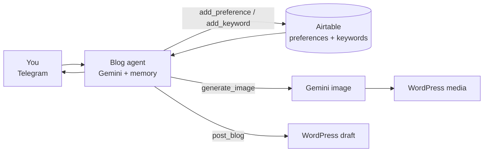

# AI Blog Assistant (n8n)

A Telegram chat assistant that takes a blog post from idea to a WordPress draft: brainstorm, cover image, outline, final post. It learns your style over time.

Built with [n8n](https://n8n.io), Google Gemini, Airtable and the WordPress API.

## What it does
1. **Brainstorm:** suggests topics based on your blog and what you ask for.
2. **Images:** generates an image with Gemini, sends you a preview and only uses it after you approve.
3. **Outline:** proposes a short structure for you to confirm before writing.
4. **Draft:** writes the full post in HTML and saves it as a **draft** on WordPress, with the image uploaded to the media library.

Along the way it saves what it learns to Airtable:
- **Preferences:** tone, brand, SEO rules ("always end with a call to action")
- **Keywords:** the meta keywords you want spread across posts

Every new conversation loads both, so posts stay consistent without repeating instructions.

## How it works

## Workflows

| File | Role |
|---|---|
| `AutomacaoBlog.json` | Main Telegram agent, with Airtable memory and tools |
| `Image Creation.json` | Generates an image with Gemini and uploads it to WordPress media |
| `Blog Posting.json` | Creates the post as a WordPress draft |

## Setup
Requirements:
- n8n
- Google Gemini API key
- Telegram bot
- Airtable base with two tables: `Preferences` and `Keywords`
- WordPress site with an application password

Steps:
1. Import `Image Creation.json` and `Blog Posting.json`, then `AutomacaoBlog.json`.
2. Create the credentials in n8n and select them in each node.
3. Replace `appSUA_BASE_AIRTABLE`, `tblSUA_TABELA_1/2` and `seu-site.com` with your Airtable IDs and WordPress URL.
4. Activate and send a message to your bot.

Posts are always saved as drafts, so nothing goes live without your review.

## Stack
n8n · Google Gemini (text + image) · Telegram · Airtable · WordPress REST API
